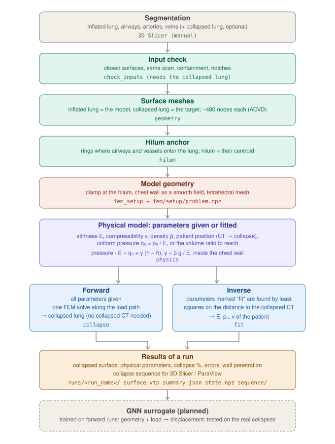
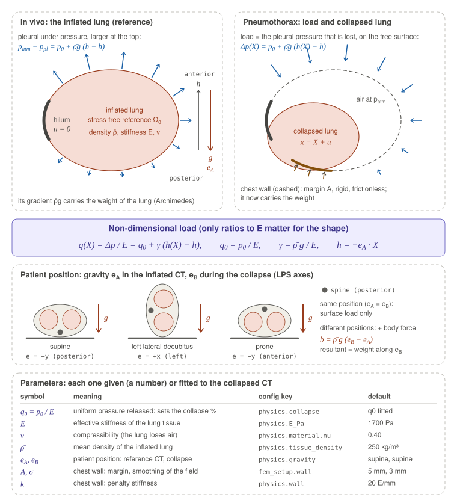
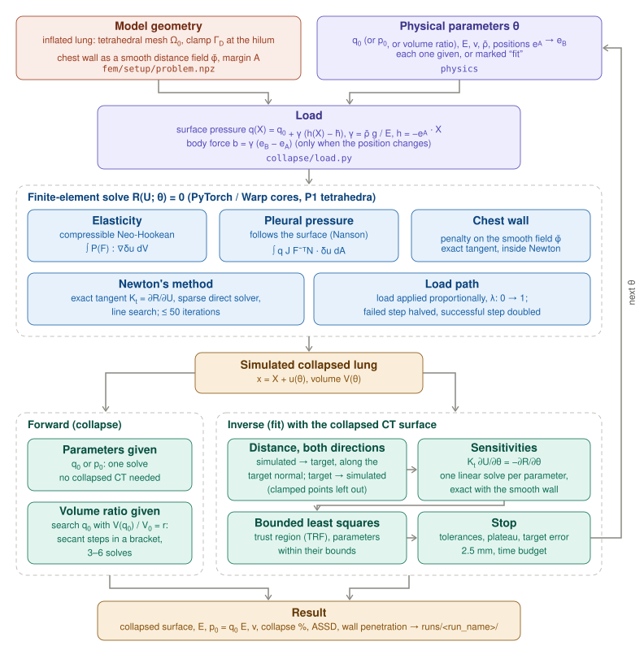

# Methodology

A finite-element model of the collapse of a lung in thoracic surgery, written as the methods section of a paper: what is modelled, the equations, how they are solved, how the parameters are fitted, and what is left out. Results and the evidence behind the choices are in [analysis/results.md](analysis/results.md); the plan in [NEXT.md](NEXT.md); every config key in [configs/README.md](configs/README.md). The methodology of the earlier regions fit is in git (`git show main:METHODOLOGY.md`).

Figures: [workflow](collapsed_lung_project_workflow.svg), [physical model](collapse_model.svg), [forward and inverse problem](inverse_fem_pressure_fit_detail.svg).

## 1. Overview

In video-assisted thoracic surgery (VATS) the operated lung is deflated. Air enters the pleural space, the lung loses the pleural pressure that kept it open and collapses towards the hilum under its elastic recoil and its own weight. The aim is a model that predicts the collapsed shape of a lung from its inflated shape and a few physical parameters, to generate the training data of a graph-neural-network surrogate.

The lung is modelled as a compressible hyperelastic body, fixed at the hilum, loaded on its surface by the pleural pressure it loses, and confined by the chest cavity. The same model is used in two ways:

- **Forward problem:** all parameters are given; one nonlinear solve returns the collapsed lung.
- **Inverse problem:** a CT of the collapsed lung is available; the parameters marked as unknown are found by least squares on the distance between the simulated and the segmented collapsed surface.

## 2. Geometry

**Input.** Closed surfaces segmented in 3D Slicer from the same CT scan: the inflated lung, the airway, pulmonary-artery and pulmonary-vein trees and, for the inverse problem, the collapsed lung. There is **one CT per patient, taken with the pneumothorax**: the collapsed lung is the lung as segmented in it, and the "inflated lung" is the **pleural cavity** of the same scan (the lung plus the pleural air), i.e. the shape the lung would have if it filled its cavity. No scan before the pneumothorax exists. Both surfaces are therefore in the same frame and the same patient position, with no registration. All coordinates are in the LPS patient frame ($x$ to the patient's left, $y$ posterior, $z$ superior), in millimetres.

**Surface meshes.** Each lung surface is cleaned (duplicate points welded, largest component kept, Taubin smoothing, holes filled) and remeshed uniformly by approximated centroidal Voronoi diagrams (ACVD) to about 480 nodes and 956 triangles, then checked to be a watertight manifold. The inflated and the collapsed mesh have their own nodes: there is no point correspondence between them.

**Hilum.** Each vascular or airway tree is intersected exactly with the lung surface; the largest intersection ring (by perimeter) is where that tree enters the lung. The hilum is the centroid of the three ring centres, with radius the mean of the three ring radii.

**Clamped region $\Gamma_D$.** The surface triangles inside the union of four balls, centred on the hilum and on the three ring centres, each of radius twice the radius of its ring (about 30 mm for the hilum). If the region holds fewer than 20 points or is nearly planar, the hilum ball grows by 10 % steps, so that no rigid motion stays free. The rest of the surface, $\Gamma_f$, is free.

**Volume mesh.** Linear tetrahedra generated by Gmsh inside the inflated surface (maximum size 14 mm), with the surface nodes and triangles unchanged; about 700–1400 nodes and 3000–7000 tetrahedra per lung.

**Chest wall.** The cavity is taken as the inflated lung surface itself: before the collapse the lung fills its cavity. A point may move beyond the wall by a margin $A_i$ = 5 mm (the accuracy of the segmentations) plus however far it already lies outside.

## 3. Physical model

### 3.1 The reference state

In vivo the lung is held open by the pleural pressure $p_{pl}$, lower than the alveolar (atmospheric) pressure, against its elastic recoil. $p_{pl}$ is not uniform: it is lower at the top of the lung, and its vertical gradient is what carries the lung's weight. For a pressure linear in height $h$ on a closed surface $\Gamma$ enclosing the volume $V$, the divergence theorem gives exactly Archimedes' force,

$$
\oint_{\Gamma} \bar\rho g\, h \; n \, dA = \bar\rho g V \, e_h ,
$$

so the lung floats in the pleural pressure field, $\bar\rho$ being its mean density (tissue, blood and air). The measured pleural gradient, about 0.25 cmH₂O per cm of height (2.5 Pa/mm), is $\bar\rho g$ for $\bar\rho \approx 250$ kg/m³. The transpulmonary pressure in the reference state is therefore

$$
p_{atm} - p_{pl}(X) = p_0 + \bar\rho g \left(h(X) - \bar h\right),
\qquad h(X) = -\,e_A \cdot X ,
$$

with $e_A$ the unit vector of gravity in the position of the reference scan (supine: $e_A = +y$), $h$ the height against gravity, $\bar h$ its area-weighted mean over $\Gamma_f$ and $p_0$ the mean transpulmonary pressure.

### 3.2 The load of the pneumothorax

When the pleural space fills with air, the pleural pressure becomes uniform and atmospheric. The lung loses the whole transpulmonary pressure of section 3.1. Taking the inflated lung as the stress-free reference configuration $\Omega_0$, the collapse is the response to an inward pressure equal to what was removed,

$$
\Delta p(X) = p_0 + \bar\rho g \left(h(X) - \bar h\right) \quad \text{on } \Gamma_f ,
$$

evaluated at the reference position $X$ of each material point: the load is the release of the in-vivo state of that point, and it follows the deforming surface (follower pressure). Its two parts have distinct roles:

- $p_0$, uniform, shrinks the lung: it sets how much the lung collapses.
- the gradient has resultant $\bar\rho g V e_A$, the weight of the lung: once the pleural gradient is gone the weight is no longer carried, and the lung settles on the dependent part of the chest wall.

No body force is applied: in the reference the weight was balanced by the pleural gradient, and both are accounted for by removing the gradient. The wall, which now carries the weight, is therefore part of the model and not an option.

### 3.3 Change of position

The inflated scan and the collapse may be in different positions (for example a supine CT and surgery in lateral decubitus). Let $e_A$ and $e_B$ be the directions of gravity in the two positions. The loads acting on the reference state are the weight along $e_A$ and the pleural gradient along $e_A$; the loads of the collapsed state are the weight along $e_B$ and a uniform pleural pressure. Their difference is the surface pressure of section 3.2, still along $e_A$, plus a body force per unit reference volume

$$
b = \bar\rho g \,(e_B - e_A) .
$$

The resultant of the two terms is $\bar\rho g V e_B$, the weight along the collapse position, whatever $e_A$ is; for $e_A = e_B$ the body force vanishes. Named positions: supine $e = +y$, prone $-y$, left lateral decubitus $+x$, right lateral decubitus $-x$.

### 3.4 Kinematics and material

With $x = X + u(X)$ the deformed position, $F = I + \nabla u$ the deformation gradient and $J = \det F$, the lung parenchyma is a homogeneous, isotropic, compressible Neo-Hookean solid with strain energy

$$
W(F) = c_1\left(J^{-2/3} I_1 - 3\right) + d_1 (J - 1)^2,
\qquad I_1 = \operatorname{tr}(F^T F),
$$

$$
c_1 = \frac{\mu}{2} = \frac{E}{4(1+\nu)},
\qquad d_1 = \frac{K}{2} = \frac{E}{6(1-2\nu)},
$$

and first Piola-Kirchhoff stress

$$
P = \frac{\partial W}{\partial F}
= c_1 J^{-2/3}\left(2F - \tfrac{2}{3} I_1 F^{-T}\right) + 2 d_1 (J - 1)\, J\, F^{-T} .
$$

The first term is isochoric (shape change), the second volumetric. The lung loses air as it collapses, so it is compressible: $\nu = 0.30$, i.e. $K = 0.83\,E$ (0.40 until 2026-11-17; $\nu$ is not identifiable from the collapsed shape, it trades off against $q_0$: analysis/results.md 5c). Under a uniform pressure the response is $p = K (1 - J)$ at any strain. $E$ is an **effective** modulus of the parenchyma as a continuum: tissue elasticity, surface tension of the alveoli and the recoil they produce are lumped in it.

### 3.5 Chest wall

The wall is rigid and frictionless (the pleural surfaces are lubricated). Let $\varphi(x)$ be the signed distance to the wall, positive outside the cavity. Non-penetration, $\varphi(x) \le A$, is enforced by a penalty force along the outward normal $\nabla\varphi$, zero inside the allowed region and growing smoothly beyond it:

$$
t_w = -\,w(g)\, \nabla\varphi, \qquad g = \varphi(x) - A,
\qquad
w(g) = \frac{k}{2e}\left(\langle g \rangle_+^2 - \langle g - e \rangle_+^2\right),
$$

with $\langle\cdot\rangle_+$ the positive part: $w$ is quadratic for $0 < g < e$ and linear with slope $k$ beyond ($k = 20\,E$/mm, $e = 0.5$ mm). The penetration beyond the margin is of the order of the contact pressure divided by $k$ (a few tenths of a millimetre).

The distance to a triangulated surface is not smooth: its gradient jumps across the edges and at the corners of the cavity (paravertebral gutter, costophrenic sulcus), where Newton's method then fails to converge. The wall is therefore represented by a **smooth field** $\tilde\varphi$: the signed distance sampled on a regular grid (spacing 1.5 mm, 30 mm around the wall), smoothed with a Gaussian filter ($\sigma$ = 3 mm) and interpolated by a tricubic B-spline, which is twice continuously differentiable. The margin of each point is measured with the same field, $A_i = 5\ \text{mm} + \langle\tilde\varphi(X_i)\rangle_+$. The smoothing rounds the corners of the wall by a few millimetres: measured against the unsmoothed wall, points go up to about 2.5 mm beyond the margin.

### 3.6 Boundary-value problem

Find the displacement $u$ of $\Omega_0$ such that

$$
\begin{aligned}
\operatorname{Div} P(F) + b &= 0 && \text{in } \Omega_0 ,\\
u &= 0 && \text{on } \Gamma_D ,\\
P N &= -\,\Delta p(X)\, J F^{-T} N \;+\; t_w && \text{on } \Gamma_f ,
\end{aligned}
$$

with $N$ the outward reference normal, $J F^{-T} N\, dA$ the current area vector (Nanson's formula) and $t_w = -w(g)\,\nabla\tilde\varphi$ the wall traction of section 3.5 per unit reference area. In weak form: find $u$ with $u = 0$ on $\Gamma_D$ such that for every admissible $\delta u$

$$
\underbrace{\int_{\Omega_0} P : \nabla \delta u \, dV}_{\text{elasticity}}
+ \underbrace{\int_{\Gamma_f} \Delta p(X)\, J F^{-T} N \cdot \delta u \, dA}_{\text{pleural pressure}}
- \underbrace{\int_{\Omega_0} b \cdot \delta u \, dV}_{\text{change of position}}
+ \underbrace{\int_{\Gamma_f} w(g)\, \nabla\tilde\varphi \cdot \delta u \, dA}_{\text{wall}} = 0 .
$$

The problem is quasi-static: inertia and viscous effects are neglected, and the collapsed state is an equilibrium.

### 3.7 Non-dimensional form and parameters

Dividing by $E$, only ratios to $E$ remain:

$$
q(X) = \frac{\Delta p}{E} = q_0 + \gamma \left(h(X) - \bar h\right),
\qquad q_0 = \frac{p_0}{E},
\qquad \gamma = \frac{\bar\rho g}{E}\ [\text{mm}^{-1}],
\qquad \frac{b}{E} = \gamma\,(e_B - e_A) .
$$

The deformed shape depends on $q_0$, $\gamma$, $\nu$ and the two positions. From shapes alone only $p_0/E$ and $\bar\rho/E$ can be identified; with $\bar\rho$ assumed, $\gamma$ gives $E$, and $p_0 = q_0 E$ follows. Without gravity $E$ would not be identifiable at all. The gravity term is written with the pressure difference between the top and the bottom of the lung, $s_g = \gamma L$, with $L$ the extent of $h$ over $\Gamma_f$ (170–230 mm):

$$
q(X) = q_0 + s_g\,\frac{h(X) - \bar h}{L}, \qquad E = \frac{\bar\rho g L}{s_g} .
$$

| Symbol | Meaning | Value | Role |
|---|---|---|---|
| $q_0 = p_0/E$ | uniform pressure released / stiffness; sets the collapse % | ~0.15–0.55 at $\nu = 0.30$ (0.3–1.1 at 0.40) | per patient: fitted, or found from the collapse % |
| $E$ | effective Young's modulus of the parenchyma | ~1–1.7 kPa (being calibrated) | common to the patients, or fitted |
| $\nu$ | Poisson's ratio | 0.30 | fixed (not identifiable) |
| $\bar\rho$ | mean density of the inflated lung | 250 kg/m³ | assumed (no CT values available) |
| $g$ | gravity | 9.81 m/s² ($\bar\rho g$ = 2.45 Pa/mm) | – |
| $e_A$, $e_B$ | gravity direction in the reference scan and during the collapse | supine, supine | chosen |
| $A$ | wall margin | 5 mm | fixed |
| $k$, $e$ | wall penalty stiffness and onset width | 20 $E$/mm, 0.5 mm | fixed (numerical) |
| $\sigma$ | smoothing of the wall field | 3 mm | fixed (numerical) |

Every physical parameter is either prescribed or marked as unknown of the inverse problem (section 6).

## 4. Discretisation and solution

### 4.1 Finite elements

Linear tetrahedra (P1), displacement degrees of freedom at the nodes, those of $\Gamma_D$ eliminated. With $\nabla N_a$ the constant gradient of the shape function of node $a$ in tetrahedron $t$ of reference volume $V_t$, and $F_t$ the constant deformation gradient, the nodal residual $R(U) = 0$ collects:

$$
R_a = \sum_{t \ni a} V_t\, P(F_t)\, \nabla N_a
\;+\; s \sum_{f \ni a} q_f\, \tfrac{1}{6}\,(x_2 - x_1) \times (x_3 - x_1)
\;-\; \sum_{t \ni a} \tfrac{V_t}{4}\, \gamma\,(e_B - e_A)
\;+\; a_a\, w(g_a)\, \nabla\tilde\varphi(x_a) .
$$

- **Pressure:** on a flat triangle $f$ with current vertices $x_1, x_2, x_3$ the area vector is $\tfrac12 (x_2 - x_1) \times (x_3 - x_1)$, shared equally by the three nodes; $q_f$ is $q$ at the reference centroid of the face. The sign $s = \pm 1$ is fixed by a start-up check so that $q > 0$ pushes inward.
- **Body force:** constant, so each tetrahedron gives a quarter of its load to each node.
- **Wall:** integrated at the nodes (vertex rule), $a_a$ being the reference area of node $a$ (a third of each adjacent free triangle), so that the force on a node depends only on its own gap. A rule with interior points and a negative weight makes the contact tangent indefinite.

### 4.2 Newton's method

$R(U) = 0$ is solved by Newton's method with the exact tangent $K_t = \partial R / \partial U$:

- *elasticity:* $K_{ab} = \sum_t V_t\, \dfrac{\partial P_{iK}}{\partial F_{jL}}\, \dfrac{\partial N_a}{\partial X_K}\, \dfrac{\partial N_b}{\partial X_L}$, with $\partial P/\partial F$ from automatic differentiation of $W$ (PyTorch core) or derived by hand (Warp core);
- *pressure* (load stiffness of the follower load, non-symmetric): the derivative of the area vector $n = a \times b$, $a = x_2 - x_1$, $b = x_3 - x_1$, with respect to the vertices, $\partial n/\partial x_1 = [b]_\times - [a]_\times$, $\partial n/\partial x_2 = -[b]_\times$, $\partial n/\partial x_3 = [a]_\times$;
- *wall:* a 3 × 3 block per node,

$$
\frac{\partial R^{wall}_a}{\partial x_a} = a_a \left[ w'(g_a)\, \nabla\tilde\varphi\, \nabla\tilde\varphi^T + w(g_a)\, \nabla^2\tilde\varphi \right],
$$

  the second term being the curvature of the wall. Because $\tilde\varphi$ is evaluated at the current position, contact is part of the same Newton iteration: there is no separate contact loop.
- the body force is a dead load and has no tangent.

Each iteration solves $K_t\, \Delta U = -R$ with a sparse direct solver (cuDSS on GPU, PARDISO or SuperLU on CPU). The step is accepted if the residual norm does not exceed 1.5 times the current one; otherwise it is scaled by 0.6 repeatedly, down to $10^{-3}$. Convergence: $\min\left(\lVert R \rVert_1,\ \lVert \Delta U \rVert_1 / \lVert U \rVert_1\right) \le 10^{-7}$, at most 50 iterations. A trial state with an inverted element ($J \le 0$), or with a surface node outside the wall grid, is rejected.

### 4.3 Load path

The whole load (surface pressure and body force) is applied proportionally, $\lambda\,(q, b)$ with $\lambda$ from 0 to 1, starting from the reference or, when a converged state is available, from that state and its load. The first increment is 1/8 of the path; an increment that fails is undone and halved, one that converges doubles the next. The solve fails if an increment below 1/64 of the path fails or after 120 s. The path is the physical one: the lung collapses as the pleural pressure is released.

### 4.4 Implementations

Three interchangeable cores solve the same equations: PyTorch (assembly with automatic differentiation, any strain energy; used for all results), NVIDIA Warp (hand-derived kernels) and GetFEM (independent reference for validation, with a linearised wall only). Newton's method, the load path, the wall and the sensitivities are shared by the first two.

## 5. Forward problem

With all parameters given, one solve along the load path returns the collapsed lung. The uniform pressure can be prescribed in three ways: as $q_0$, as $p_0$ in Pa, or through the volume to reach, $r = V_{collapsed} / V_{inflated}$ with

$$
V = \tfrac{1}{6} \sum_{f} x_1 \cdot (x_2 \times x_3) .
$$

$V$ decreases monotonically with $q_0$, so $q_0(r)$ is found by a one-dimensional search: first guess from the hydrostatic response, $q_0 = (1 - r)\,K/E$; extrapolation by at most a factor 2 until the target is bracketed; then secant steps kept inside the bracket; each solve starts from the previous state. Three to six solves give $r$ within 0.5 %.

**Prediction rule.** For a new lung the only input is the collapse % (the volume ratio $r$). $\nu$ = 0.30 is fixed; $q_0$ follows from $r$ as above; the gravity slope, i.e. $E$ at the nominal $\bar\rho$ = 250 kg/m³, from a rule fitted on the patients' inverse fits (E and $q_0$ fitted, 12 patients with $E$ inside its bounds):

$$
\log_{10} E\,[\text{Pa}] = 3.630 - 0.01346 \times \text{collapse \%} ,
$$

about 2.0 kPa at 25 % and 0.9 kPa at 50 % ($r$ = −0.87, residual 0.16 in $\log_{10} E$). In leave-one-out the predicted shape is 0.2 mm (median) worse than the patient's own fit; the density measured on the CT does not improve it (analysis/results.md 5e–5f), so it is used only to report $E$ and $p_0$ in physical units.

A collapse sequence is obtained by solving at $\lambda = 0 \ldots 1$ of the final load: the intermediate shapes are equilibria of the proportional load, not a linear morph.

## 6. Inverse problem

### 6.1 Objective

Given the collapsed surface $\Gamma^c$ (points $y_j$, $j = 1 \ldots n_t$), the unknown parameters $\theta$ (any of $q_0$, $s_g$ i.e. $E$, $\nu$) minimise the distance between the simulated surface and $\Gamma^c$ in both directions:

$$
\min_{\theta_{lo} \le \theta \le \theta_{hi}} \;
\sum_{i \in \text{free}} \lVert r_i \rVert^2
+ w_s \frac{n_f}{n_t} \sum_{j=1}^{n_t} \lVert b_j \rVert^2 .
$$

- **Simulated → target:** for each free simulated node $x_i$, with $c_i$ its closest point on $\Gamma^c$ and $n_i$ the normal there (vertex normals interpolated on the triangle),

$$
r_i = n_i n_i^T (x_i - c_i) ,
$$

  the distance along the target normal. $c_i$ and $n_i$ are recomputed at every evaluation. The surfaces share no point correspondence, and sliding along the target costs nothing.
- **Target → simulated:** for each target point $y_j$, with $z_j = \sum_m \beta_{jm}\, x_{v_m}$ its closest point on the simulated surface (barycentric weights $\beta$ on the triangle with vertices $v_m$),

$$
b_j = z_j - y_j ,
$$

  set to zero when $z_j$ falls on a clamped triangle. Without this term a lung that shrinks onto a part of the target scores well while the rest of the target stays uncovered.
- Each term is averaged over its own number of points ($n_f$ free nodes, $n_t$ target points), $w_s = 1$. The clamped nodes do not move and are left out of the objective and of every reported error.

The reported shape error is the average symmetric surface distance (ASSD), the mean of the point-to-surface distances in the two directions.

### 6.2 Optimiser and sensitivities

The problem is solved by a bounded trust-region least-squares method (Trust Region Reflective, SciPy), with bounds $q_0 \in [-1, 3]$, $E \in [0.3, 10]$ kPa, $\nu \in [0.05, 0.45]$. The Jacobian is analytic. The load is linear in the parameters, $q = \Phi\,\theta + q_c$ and body magnitude $= \beta^T\theta + \beta_c$, so differentiating $R(U; \theta) = 0$ at the converged state gives, with one factorisation of the tangent,

$$
K_t \frac{\partial U}{\partial \theta} = -\frac{\partial R}{\partial \theta},
\qquad
\frac{\partial R}{\partial q_f} = s\,\tfrac{1}{6}\,(x_2 - x_1) \times (x_3 - x_1)\ \text{on the nodes of } f,
\qquad
\frac{\partial R}{\partial \nu} = \frac{\partial f_{int}}{\partial \nu} ,
$$

i.e. one linear solve per parameter instead of one nonlinear solve. The column of $q_0$ is $\Phi = 1$ on $\Gamma_f$, that of $s_g$ is $(h - \bar h)/L$ plus the body-force column. With the smooth wall field the contact terms are in $K_t$, so the sensitivities are exact. The residual Jacobian holds the closest points fixed (Gauss-Newton):

$$
\frac{\partial r_i}{\partial \theta} = n_i n_i^T \frac{\partial u_i}{\partial \theta},
\qquad \frac{\partial b_j}{\partial \theta} = \sum_m \beta_{jm} \frac{\partial u_{v_m}}{\partial \theta} .
$$

### 6.3 Procedure

- A start-up solve checks the sign convention of the pressure.
- Before each solve the model is restarted from the state of lowest cost found so far, with its load, so that a shrinking trust region means a shrinking load increment.
- A solve that does not converge is a rejected trial: its residual is set to twice the best one.
- The fit stops on the optimiser's tolerances ($10^{-6}$ relative change of cost or parameters), when the best error improves by less than 0.5 % over three iterations, at an error of 2.5 mm, or on a time budget. The result is the state of lowest root-mean-square distance.

### 6.4 Diagnostic perturbations

To measure what the physical load misses, a free term $\delta q$ can be added to $q$ and fitted with it:

- **free slopes** along anatomical axes, $\delta q = \sum_a s_a\, \xi_a(X)$, $\xi_a$ the normalised coordinate along the antero-posterior, supero-inferior or medio-lateral axis;
- **regional pressures**, one value per region of a partition of $\Gamma_f$ (connectivity-constrained Ward clusters of the normal displacement towards the collapsed lung, 1 to 40 regions, fitted coarse to fine with a penalty $\lambda^2 \sum (\theta_a - \theta_b)^2$ on adjacent regions). The regions come from the patient's own collapse, so this fit cannot predict; it gives the best shape the model can reach (about 3 mm) and shows where pressure is missing.

These terms are not part of the physical model and are never used in prediction.

## 7. Assumptions and what is not modelled

**Assumptions of the model.**

1. *Stress-free reference.* The inflated lung is taken as unstressed. In vivo it is prestressed by the recoil and by its weight. A rigorous treatment needs the unloaded geometry (a further inverse problem); to first order in the load the two coincide, the difference being the stiffening due to the prestress.
2. *Homogeneous, isotropic material.* One $E$, $\nu$ and $\bar\rho$ for the whole lung. No CT values of the inflated lung are available, so there is no per-element density or air fraction, although the dependent lung is denser.
3. *No limit to compression.* The volumetric term $(J-1)^2$ stays finite as $J \to 0$: an element can lose more volume than the air it contains, and a uniform $q$ above $K/E$ (0.83 at $\nu = 0.30$) has no equilibrium. A barrier at the tissue fraction ($J \ge \phi_t$) would remove this; it needs the air fraction.
4. *Effective elasticity.* Surface tension, airway closure and the recruitment / derecruitment of alveoli are not modelled; their net effect is in $E$ and $\nu$.
5. *Quasi-static.* No inertia, viscoelasticity or time: the model gives the final equilibrium, not how fast the lung deflates, nor the absorption atelectasis that continues over minutes.
6. *Rigid clamp.* The hilum does not move; the pulmonary ligament and the bronchial and vascular tethering beyond the hilum region are not modelled.
7. *Rigid, frictionless wall equal to the inflated lung.* The diaphragm, the mediastinum and the heart move in a pneumothorax and are softer than the ribs; adhesions and friction are absent. The wall is smoothed over ~3 mm.
8. *One body.* The lobes are not separated: no sliding along the fissures, no self-contact of the lung surface, no folding.
9. *Mean density assumed* ($\bar\rho$ = 250 kg/m³). Since only $\bar\rho / E$ matters for the shape, an error in $\bar\rho$ is an error of the same relative size in the calibrated $E$.
10. *Patient position.* The scan is assumed supine (the pleural air is anterior in 15 / 15 patients); the buoyancy of the pleural air (~1/200 of the lung's weight) and the small motion of the lung while the patient is turned with the chest closed are neglected.
11. *No surgical action.* Instruments, retraction, one-lung ventilation settings and residual airway pressure are outside the model; a residual pressure is absorbed in $p_0$.
12. *The cavity as the inflated lung.* The reference is the pleural cavity of the pneumothorax scan, not the lung before the pneumothorax. With the pleural pressure lost the chest wall springs outward, the mediastinum shifts to the other side and the hemidiaphragm flattens, so the cavity is larger than the lung that filled it, and shaped differently on its medial and diaphragmatic faces. The collapse % measured against it is an overestimate, and the model must also "collapse away" volume the lung never occupied. The size of this error is unknown and probably grows with the size of the pneumothorax.

**Approaches tried and abandoned** (evidence in analysis/results.md; the code is in git on `main`).

| Approach | Why it was left |
|---|---|
| Image registration of the collapsed onto the inflated mask (elastix), node-to-node target | the correspondence is not anatomical: nodes slide along the surface, the fit chased that slip as a rotation; wrong reference volumes on some patients |
| Rigid alignment of the target on the hilum | it rotated the target out of the cavity (karl04: 16°, 22 points beyond the wall) for no gain |
| Clamping the points that "do not move" | without correspondence every point that slid onto the target counted as fixed |
| Point-to-point and one-sided objectives | sensitive to tangential slip; the one-sided distance let the lung shrink onto a part of the target |
| Regional pleural pressures as the model | reproduce the shape (~3 mm) but come from the patient's own collapse: they cannot be transferred to another lung. Kept only as a diagnostic (6.4) |
| Free linear pressure gradients as the model | the antero-posterior slope found is the gravity term; a free slope per patient has no physical meaning beyond it. Kept only as a diagnostic |
| Wall linearised at a state, with outer re-linearisation rounds | the rounds alternate at the corners of the wall and solves fail (14–29 % of them); a cold start with the gravity load was often impossible |
| Wall updated inside Newton without the curvature term | residual two-cycle (the tangent missed the rotation of the normal) |
| Tangential elastic support of the surface | an artificial substitute for friction against the near-rigid swing about the hilum; took 5–12 % of the load, helped some patients and hurt others. With gravity and the wall it is not needed |
| Continuation in the gravity term | a numerical path needed only by the linearised wall; with the smooth wall every solve follows the physical load path |
| Finite-difference Jacobian, Nelder-Mead | about 20× more solves than the analytic sensitivities for the same result (karl04: 1416 vs 71) |

## 8. Verification

- **Cores.** PyTorch and Warp against GetFEM on the same mesh: relative difference of the displacements ≤ 2·10⁻¹⁴ without wall, ≤ 10⁻¹¹ with the linearised wall; analytic sensitivities against central finite differences ~10⁻⁸.
- **Smooth wall.** Tangent against finite differences of the residual 10⁻⁷; sensitivities with contact against finite differences 3·10⁻⁸ (PyTorch core on the server, 5 columns).
- **Body force.** Resultant equal to the weight along the collapse position; sensitivity column against finite differences 10⁻⁷.
- **Inverse problem.** A fit of $(q_0, E)$ on a synthetic target generated by a forward run recovers the parameters ($q_0$ to 10⁻⁴, $E$ within 0.1 %). The symmetric term's gradient is exact (2·10⁻¹⁰ against finite differences); the simulated → target term is Gauss-Newton only, because on a triangulated target the interpolated normal is not the gradient of the distance.
- **Robustness.** With the smooth wall, fits from the reference with the whole gravity load, at $E$ = 1.7 and 1 kPa on four patients: no failed solve, under one minute each.

## 9. Implementation

| File (`pipeline/`) | Content |
|---|---|
| `surface_mesh.py`, `hilum.py`, `check_inputs.py` | section 2 |
| `collapse/setup.py`, `wall_field.py` | clamp, wall field, volume mesh (sections 2, 3.5) |
| `collapse/load.py` | the load as a function of the parameters, its linear structure and the chain rule (3.7, 6.2, 6.4) |
| `collapse/solvers/nodal.py` | Newton, load path, wall, body force, sensitivities (section 4) |
| `collapse/solvers/torch_solver.py`, `warp_solver.py`, `getfem_solver.py`, `materials.py` | the three cores and the strain energies (3.4, 4.4) |
| `collapse/forward.py` | forward problem (section 5) |
| `collapse/fit.py` | inverse problem (section 6) |
| `tests/` | the checks of section 8 that run without the FEM libraries |
