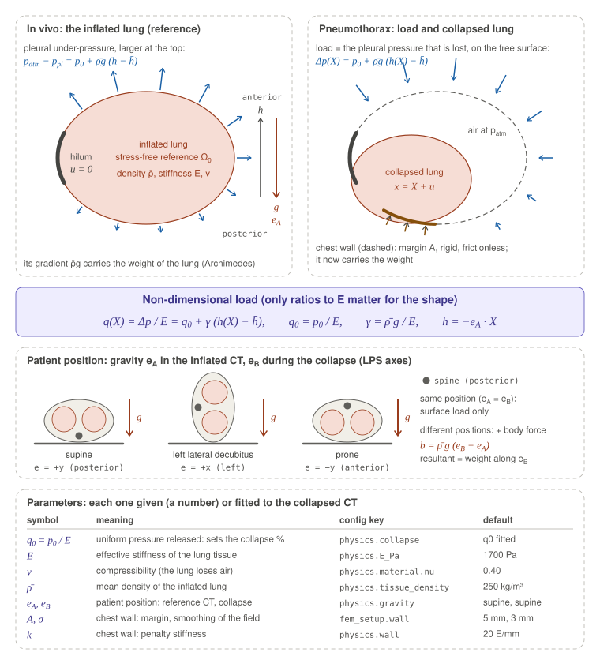
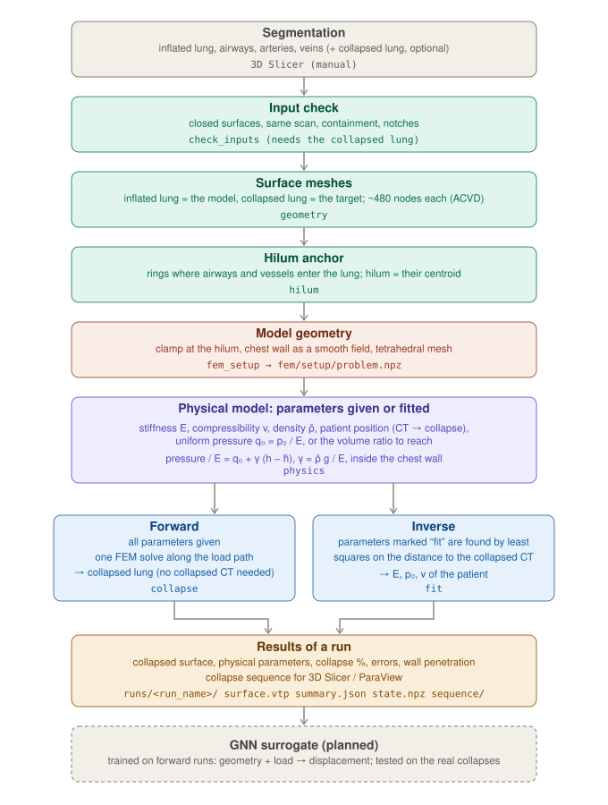

# eurelaps_lung: lung collapse model

A finite-element model of the collapse of a lung in VATS surgery, built from CT segmentations, as the Python package `eurelaps_lung` (Eureka + collapse: the load is Archimedes' hydrostatics, the pleural pressure gradient that carried the lung's weight) with three entry points. Given the inflated lung, it predicts the collapsed one from a few physical parameters (stiffness, density, patient position, how much the lung collapses); given also the collapsed lung, it fits those parameters to it. The simulations are the training data for a GNN surrogate.

**The model** (details and equations in [METHODOLOGY.md](METHODOLOGY.md)): the inflated lung is an elastic body, fixed at the hilum. In the pneumothorax it loses the pleural pressure that kept it open, and with it the pressure gradient that carried its weight, so it shrinks and settles on the chest wall:

```
pressure on the surface / E  =  q0  +  γ (h − h_mean),      γ = density · g / E
```

| Parameter | Config key | Meaning |
|---|---|---|
| E | `physics.E_Pa` | effective stiffness of the lung tissue [Pa] |
| ν | `physics.material.nu` | compressibility (the lung loses air) |
| density | `physics.tissue_density` | mean density of the inflated lung in the model [kg/m³] (200: the pleural gradient 0.2 cmH₂O/cm / g) |
| CT density | `physics.ct_density` | the same measured on the CT, report only: E and p0 also given rescaled to it |
| emphysema | `physics.emphysema`, `physics.ct_emphysema` | yes / no, your reading of the CT; and its volume, LAA%−950 [%] from the CT (used by the barrier when yes) |
| compression limit | `physics.barrier` | the lung cannot lose more volume than its air that can leave: J ≥ φ = tissue + trapped emphysematous air (from the CT); `null` = none. Needed for surgical pressures (12 mmHg) |
| position | `physics.gravity` | patient position in the inflated CT and during the collapse (sets "up": h) |
| q0 | `physics.collapse` | uniform pressure / E: it sets how much the lung collapses. Given as `q0`, as `p0_Pa`, or as the `volume_ratio` to reach |
| wall | `fem_setup.wall`, `physics.wall` | the chest cavity the lung may not leave |

Each physical parameter is either **given** (a number) or **fitted** to the collapsed lung (`{"fit": true, "init": ..., "bounds": [...]}`).



## Steps



| Step | Code | What it does | Main output |
|---|---|---|---|
| segmentation | manual, 3D Slicer | surfaces of the lungs, airways and vessels | `<data_dir>/*.vtk` |
| `check_inputs` | [check_inputs.py](eurelaps_lung/check_inputs.py) | finds segmentation problems before they break the meshing (needs the collapsed lung) | `checks/` |
| `geometry` | [surface_mesh.py](eurelaps_lung/surface_mesh.py) | clean, uniform surface meshes (~480 nodes) of the inflated lung and, if given, of the collapsed one | `lung_inflated_mesh.vtp`, `lung_collapsed_mesh.vtp` |
| `hilum` | [hilum.py](eurelaps_lung/hilum.py) | where airways, arteries and veins enter the lung | `hilum_anchor.mrk.json` |
| `fem_setup` | [fem/setup.py](eurelaps_lung/fem/setup.py) | clamp at the hilum, chest wall, tetrahedral mesh | `fem/setup/problem.npz` |
| `collapse` | [fem/forward.py](eurelaps_lung/fem/forward.py) | **forward:** all parameters given → collapsed lung | `runs/<run_name>/` |
| `fit` | [fem/fit.py](eurelaps_lung/fem/fit.py) | **inverse:** fits the parameters marked `fit` to the collapsed lung | `runs/<run_name>/` |

## Setup

The package is `eurelaps-lung` (`pyproject.toml`, Python >= 3.10). From a clone:

```bash
pip install -e ".[standalone]"     # prediction: numpy, scipy, pyacvd, netgen-mesher + vtk + torch
pip install -e ".[server]"         # everything for fits and cohorts (+ scikit-learn, itk, cuDSS, pypardiso, Warp)
```

From GitHub, without cloning: `pip install "eurelaps-lung[standalone] @ git+https://github.com/edoardoedr/lung_collapse.git@v0.1.0"`. The plain install (no extra) is the prediction path without `vtk` and `torch`, for hosts that already have them (3D Slicer: [SLICER_EXTENSION.md](SLICER_EXTENSION.md)). `requirements.txt` installs the same as `[server]` from the clone.

FEM cores (`solver.core`): **PyTorch** (default, extra `torch`; on GPU, cuDSS from `gpu`), **Warp** (extra `warp`), **GetFEM** (validation only, not on PyPI: `conda install -c conda-forge getfem`).

## Running

Three entry points, all driven by the patient's config:

| Entry point | Input | What it does | Output |
|---|---|---|---|
| `main_fit.py` | one config, inflated + collapsed lung | builds the model and fits the parameters marked `fit` to the collapsed lung | `runs/<run_name>/` |
| `main_calibrate.py` | many configs | fits every patient, then the population rule (E from the collapse %) and its leave-one-out test | rule file `calibration/<rule>_<fit-run>.json` |
| `main_predict.py` | one config, inflated lung (collapsed optional) + collapse % + parameters | forward run: the collapsed lung | `runs/<run>/` (+ Slicer sequence) |

**Fit one patient** (`main_fit.py`): the steps listed in the config, or `--steps`, always in order check_inputs → geometry → hilum → fem_setup → fit.

```bash
python main_fit.py --config configs/karl04.json                   # the steps listed in the config
python main_fit.py --config configs/karl04.json --steps fit       # only some steps
```

One-off changes without editing the config: `--set key=value ...` (value parsed as JSON; a misspelt key is an error). Give each variant its own `run_name`, so it goes to its own folder:

```bash
# fit the collapse pressure with another stiffness
python main_fit.py --config configs/karl04.json --steps fit --set physics.E_Pa=1000 run_name=E1000

# fit the stiffness too
python main_fit.py --config configs/karl04.json --steps fit \
    --set 'physics.E_Pa={"fit": true, "init": 1360, "bounds": [300, 10000]}' run_name=fitE
```

**Calibrate on the cohort** (`main_calibrate.py`): (1) the fit of every patient with the chosen parameters free (`--fit E [nu]`, q0 always), (2) the rule log10 E = a + b · collapse % on the patients whose E is not at a bound (E bounds 160–16000 Pa at ρ̄ 200, scaled with the config's density; a fit at another density is judged at 200), written to a JSON file, (3) leave-one-out: every patient predicted with the rule of the others. Rules `E_rho` / `sg_rho` also use the CT density (`--density`, csv of `scripts/ct_density.py`).

```bash
python main_calibrate.py --configs configs/*.json --fit E --jobs 4                  # fits + rule + leave-one-out
python main_calibrate.py --configs configs/*.json --fit E --fit-run fitE_nu30 --skip-fit --no-loo   # rule from existing fits
```

**Predict** (`main_predict.py`): the inflated lung collapsed to a given collapse % (q0 searched to reach that volume), with E from a rule file (`--params`), from a fit of the same patient (`--from-fit RUN`), or from the config. Or driven by the pressure: `--p0 330 --E 1300` (the collapse % is then the result; the E rule needs the collapse %, so E is given). `--estimate` prints what the rules expect without running (the p0 of a collapse %, the collapse % of a p0 and E). Any other parameter with `--set`.

**The rules** (E from the collapse %, and q0 = p0 / E from the collapse % for the estimates) are a file, not code: `eurelaps_lung/data/rules.json` by default. After new fits or new patients, `python main_calibrate.py ... --make-default` writes the new rules there (then raise the package version); a rule file can also be used without changing the default, with `--params FILE` or, for a whole process (e.g. the 3D Slicer extension), the environment variable `EURELAPS_RULES=FILE`.

```bash
python main_predict.py --config configs/karl04.json --collapse 50 --params calibration/E_fitE.json --frames 30
python main_predict.py --config configs/karl04.json --collapse 50 --from-fit fitE --run half_fitE
python main_predict.py --config configs/karl04.json --p0 330 --E 1300 --run p330     # pressure given
python main_predict.py --estimate --collapse 50                                      # the rules' estimate only

# patient on the left side during the collapse
python main_predict.py --config configs/karl04.json --collapse 50 --params calibration/E_fitE.json \
    --set 'physics.gravity={"reference": "supine", "collapse": "left_lateral"}' --run half_lateral
```

**A new patient (no collapsed lung):** export from 3D Slicer the inflated lung and the airway, artery and vein trees as `.vtk`; copy `configs/templates/new_patient.json` to `configs/<patient>.json` and set `patient`, `data_dir`, `output_dir` and the file names; optionally the density from the CT, `python scripts/ct_density.py --config configs/<patient>.json --ct <ct.nii.gz> --write-config`; then `python main_predict.py --config configs/<patient>.json --collapse 50 [--params ...] --frames 30`. The first run builds the geometry (geometry → hilum → fem_setup); the next ones reuse it. Without `--params`, E comes from the built-in rule (`physics.E_Pa {"rule": "collapse"}`).

**Several patients:** `JOBS=4 bash scripts/run_all.sh [case ...] [-- main_fit.py arguments]` (logs in `logs_run_all/`). One parameter shared by all patients, scanned over values: `python scripts/fit_cohort.py --configs configs/karl*.json --param physics.E_Pa --values 1000 1700 3000`. Every patient predicted at its own collapse %: `python scripts/predict_cohort.py --configs configs/*.json [--params ...]`. A table of all runs: `python scripts/summarize_runs.py <results folder>`.

If a step fails, the error is in `logs/fit.log` (or `predict.log`) and the run stops.

**As a library:** prediction with `from eurelaps_lung import predict; cfg = predict.default_config()` (the calibrated defaults), fill in `patient`, `data_dir`, `output_dir`, `inputs`, then `summary = predict.run(cfg, collapse=40, frames=30)` or `predict.run(cfg, p0=330, E=1300)` (also `python -m eurelaps_lung.predict --config c.json --collapse 40`, the entry point of the 3D Slicer extension). `--collapse target` / `collapse="target"` takes the collapse % of the collapsed lung of the config (validation). `predict.estimate(collapse=40)` / `predict.estimate(p0=330, E=1300)`: the rules' expectation before a run; `predict.rules()`: the rules in use. `summary["prediction"]`: how the run was driven and that estimate. Lower level: `from eurelaps_lung.config import load_config` (a file or a dict), `from eurelaps_lung.fem import forward, fit`, `from eurelaps_lung import calibration`.

## Input data

One folder per patient (`data_dir`), surface models exported from 3D Slicer (`.vtk`), all from the same scan: the inflated lung (`lung_left.vtk`), the airway, artery and vein trees, and optionally the collapsed lung (`lung_left_collapsed.vtk`). Without the collapsed lung set `inputs.collapsed` to `null` and use `main_predict.py` only.

## Configuration

One JSON per patient in [`configs/`](configs/); **every key is explained in [`configs/README.md`](configs/README.md).** In short:

| Section | Content |
|---|---|
| `inputs` | the surface files |
| `check_inputs`, `geometry`, `hilum`, `fem_setup` | how the model is built (mesh sizes, clamp, wall) |
| `physics` | the model's parameters, given or fitted |
| `solver` | FEM core (`torch`, `warp`, `getfem`) and its numerical options |
| `collapse`, `fit` | options of the forward and of the inverse run |
| `run_name` | folder of this run under `runs/` |

## Results

```
<output_dir>/
├── lung_inflated_mesh.vtp, lung_collapsed_mesh.vtp    surface meshes (geometry)
├── hilum_anchor.mrk.json                              hilum + airway / artery / vein entries
├── checks/  hilum/
├── fem/setup/           problem.npz, reference.vtp, target.vtp, volume.vtu, setup_summary.json
├── runs/<run_name>/     surface.vtp     collapsed lung: Displacement_mm, Pressure_Pa, Error_mm, WallPenetration_mm
│                        summary.json    physical parameters (E, p0, q0, ν, gravity), collapse %, errors, solves
│                        state.npz       the solution, to re-solve it (sequence)
│                        sequence/       collapse sequence for Slicer / ParaView
│                        history.csv, best_state.npz, best_params.json    (fit)
└── logs/                fit.log / predict.log, config used
```

All surfaces are in LPS, with the space stored in the file.

## Viewing

**Animated:** `python scripts/collapse_sequence.py --config configs/<p>.json [--set run_name=...]` (or `--frames` of `main_predict.py`) writes `runs/<run_name>/sequence/`. Copy the folder to the machine with Slicer and open it:

```bash
/Applications/Slicer.app/Contents/MacOS/Slicer --python-script <folder>/load_collapse_in_slicer.py
```

or, with Slicer open, in its Python console:

```python
p = '<folder>/load_collapse_in_slicer.py'
exec(open(p).read(), {'__file__': p})
```

**Several runs side by side,** in Slicer's Python console:

```python
exec(open('<repo>/scripts/slicer_compare_sequences.py').read())
load('<output_dir>/runs/fit/sequence', '<output_dir>/runs/E1000/sequence')
```

**Static:** drag `runs/<run_name>/surface.vtp` and `fem/setup/target.vtp` into Slicer and colour the surface by `Error_mm`.

## More

| File | Content |
|---|---|
| [configs/README.md](configs/README.md) | every config key |
| [METHODOLOGY.md](METHODOLOGY.md) | the model, the equations, the solver, the fit, what is not modelled (with the [forward / inverse figure](inverse_fem_pressure_fit_detail.svg)) |
| [analysis/results.md](analysis/results.md) | results and the evidence behind the choices |
| [NEXT.md](NEXT.md) | plan and to-do |
| [CLAUDE.md](CLAUDE.md) | development notes: code architecture, validation, tests |
